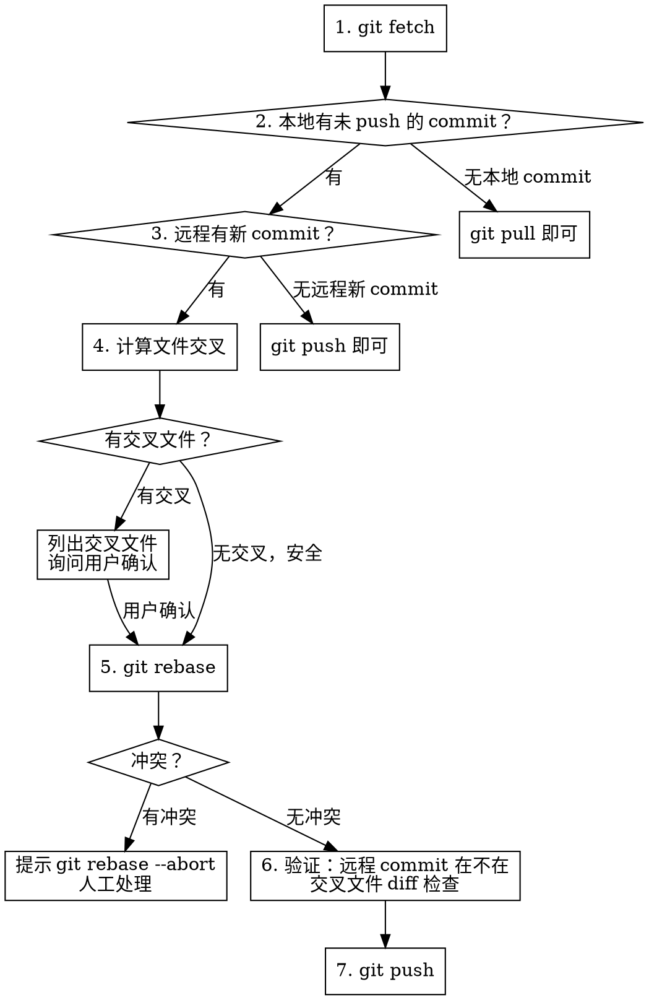

# Safe Rebase & Push

安全地将本地 commit rebase 到远程最新代码之上并 push。核心原则：**rebase 前检查文件交叉，rebase 后验证别人的代码没丢。**

## When to Use

- `git push` 被 reject（remote contains work that you do not have locally）
- 需要拉取远程更新并保持线性历史
- 任何需要 `git pull --rebase` 的场景

## 流程



## 执行步骤

### Step 1: Fetch

```bash
git fetch origin <branch>
```

### Step 2-3: 检查本地/远程状态

```bash
# 本地有多少 commit 未 push
git log origin/<branch>..HEAD --oneline

# 远程有多少新 commit
git log HEAD..origin/<branch> --oneline
```

- 本地无 commit → `git pull` 结束
- 远程无新 commit → `git push` 结束
- 两边都有 → 继续

### Step 4: 计算文件交叉

```bash
MERGE_BASE=$(git merge-base HEAD origin/<branch>)

# 我改了哪些文件
git diff --name-only $MERGE_BASE HEAD

# 远程改了哪些文件
git diff --name-only $MERGE_BASE origin/<branch>

# 交叉文件（两边都改了的）
comm -12 \
  <(git diff --name-only $MERGE_BASE HEAD | sort) \
  <(git diff --name-only $MERGE_BASE origin/<branch> | sort)
```

**无交叉** → 直接 rebase，不会有冲突
**有交叉** → 列出交叉文件，告知用户，等用户确认再继续

### Step 5: Rebase

```bash
git rebase origin/<branch>
```

如果冲突：
- 提示用户 `git rebase --abort` 可以安全回退
- 不要自动 `--skip` 或 `--theirs`，让用户决定

### Step 6: 验证

```bash
# 1. 确认远程所有 commit 都已成为 HEAD 的祖先
git merge-base --is-ancestor origin/<branch> HEAD && echo "OK: 远程 commit 全部包含"

# 2. 如果 Step 4 有交叉文件，逐个检查远程的改动还在不在
#    用 rebase 前保存的 MERGE_BASE，确认远程在该文件上的改动已体现在 HEAD 中
git diff $MERGE_BASE HEAD -- <overlap_file>
#    输出应同时包含你的改动和远程的改动
#    如果缺少远程的改动（对比 Step 4 远程 diff 的内容），说明 rebase 丢了东西
```

### Step 7: Push

```bash
git push origin <branch>
```

## Common Mistakes

| 错误 | 后果 | 正确做法 |
|------|------|---------|
| 直接 `git pull --rebase` 不看交叉 | 冲突时误选自己的版本，覆盖别人代码 | 先 fetch + 检查交叉 |
| 冲突时选 `--theirs` 或 `--ours` 批量解决 | 丢失一方的改动 | 逐文件人工解决 |
| rebase 后不验证就 push | 覆盖了别人代码但不知道 | rebase 后检查交叉文件 diff |
| `git push --force` | 覆盖远程所有新 commit | 永远不要 force push 到共享分支 |
